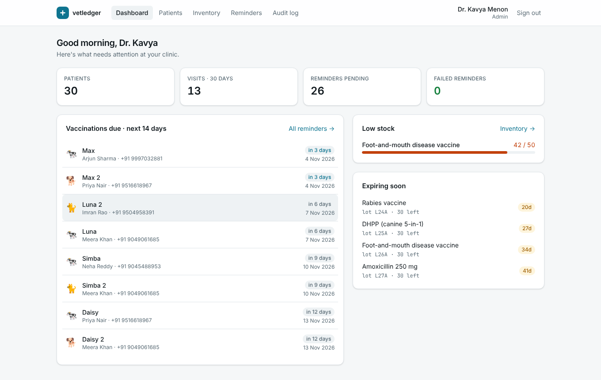
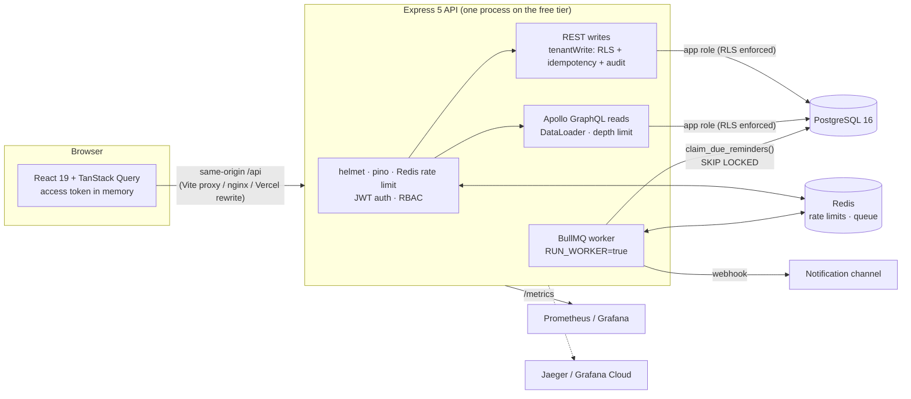
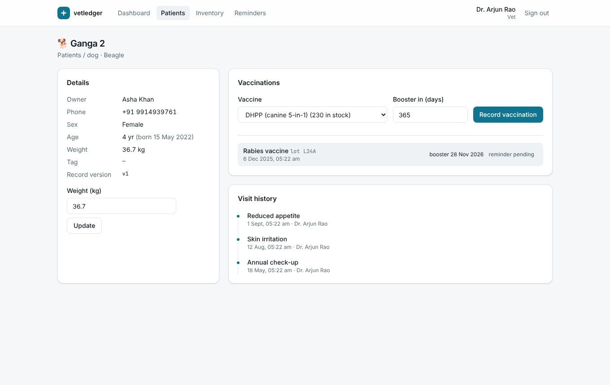
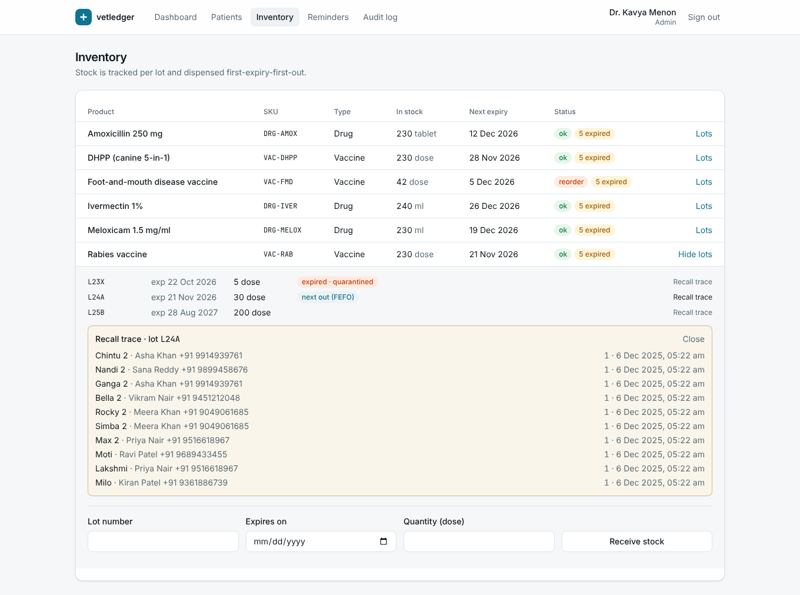
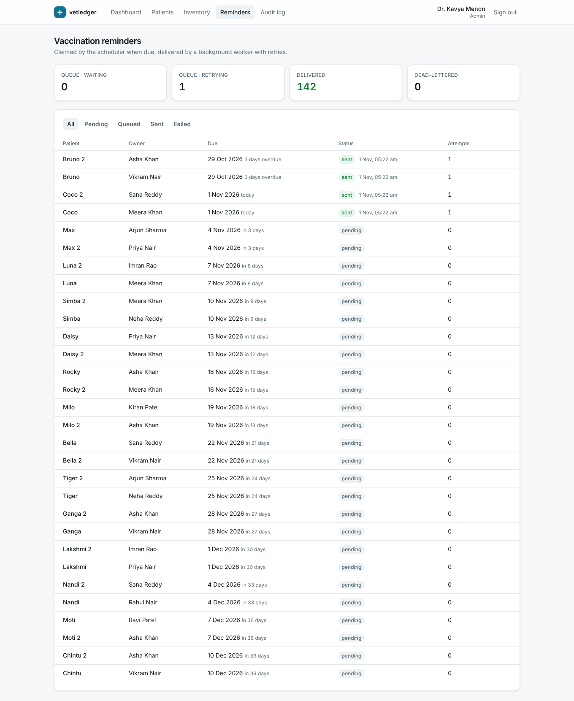
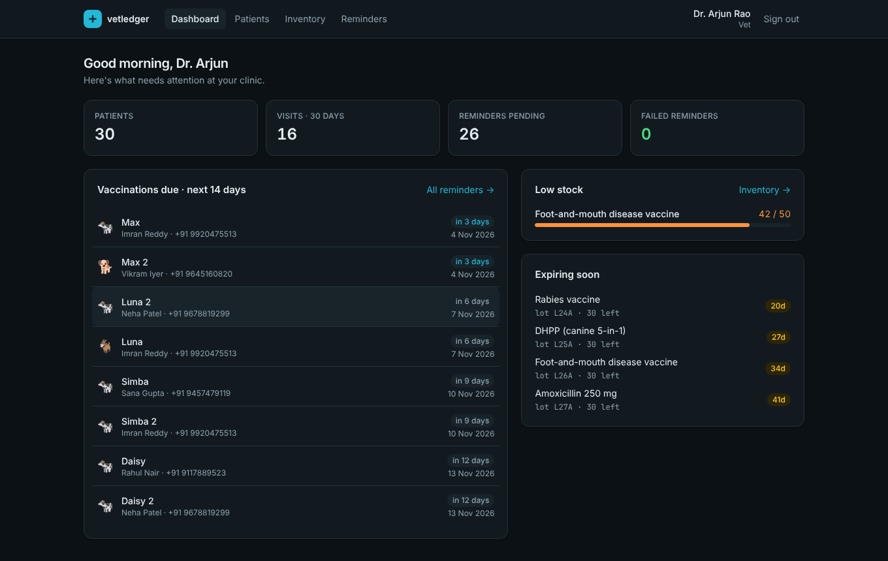

# vetledger

**Multi-tenant veterinary clinic & livestock health platform.** Patient records, visit history, lot-tracked drug and vaccine inventory dispensed first-expiry-first-out, and vaccination reminders delivered by a background worker. Tenant isolation is enforced by **PostgreSQL row-level security**, not just application code.

[](https://github.com/AtishayKashyap/vetledger/actions/workflows/ci.yml)


**[▶ Live demo](https://vetledger.vercel.app)**: log in as `vet@sunrise.vet`, password `vetledger-demo` (try `vet@deccan.vet` in a private window to see a second clinic). Hosted on free tiers (Vercel, Render, Neon, Upstash), so the first request after a quiet spell can take ~50 s while the API wakes up. Feel free to change things; the demo data can be reset at any time.



## What's interesting here

| Problem | Solution | Proof |
|---|---|---|
| A forgotten `WHERE clinic_id = ?` leaks another clinic's data | **Row-level security** on every tenant table. The API connects as a non-owner role and scopes each transaction with `set_config('app.clinic_id', …, true)`. With no tenant set it fails closed. | Tests show cross-tenant reads return 404, cross-tenant writes are rejected by Postgres, and a query *with no tenant filter at all* still sees only its own clinic. Disabling RLS makes those tests fail. ([ADR 0001](docs/adr/0001-row-level-security.md)) |
| Two vets dispense the last vials at the same moment | **FEFO allocation** under `SELECT … FOR UPDATE` in a deterministic lock order, plus a `CHECK (quantity >= 0)` backstop. The ADR explains why `SKIP LOCKED` would be wrong here. | 20 concurrent prescriptions against 10 units: exactly 10 succeed and 10 get `409 Insufficient Stock`. Stock ends at 0 and allocations sum to 10. ([ADR 0002](docs/adr/0002-fefo-locking.md)) |
| A double-click or network retry dispenses twice | **Idempotency keys**, stored in the *same transaction* as the write. Concurrent duplicates race on a primary key, so only one commits. | 8 parallel requests with the same key dispense once. A replay returns the original response, and reusing a key with a different body returns 422. |
| Two staff edit the same record | **Optimistic concurrency**: `If-Match` maps to a version compare-and-swap in a single `UPDATE`. | A stale writer gets `409` with the current version, and the UI offers "Reload latest". |
| A stolen refresh token stays valid for weeks | **Rotating refresh tokens with reuse detection**: httpOnly, SameSite=strict, stored as SHA-256. Replaying a rotated token revokes the whole family. | Integration test, plus a client test proving concurrent 401s share a single refresh. ([ADR 0003](docs/adr/0003-refresh-token-rotation.md)) |
| Reminders must go out once, survive crashes and retry | **BullMQ** with a Redis-stored job scheduler. Claims use `FOR UPDATE SKIP LOCKED` (the right call here), jobs are deduped by `jobId`, retries use exponential backoff, and exhausted jobs land in a dead-letter state with an admin retry. | Overlapping scans claim each reminder once. An end-to-end worker test covers a transient failure, a retry, and delivery. ([ADR 0005](docs/adr/0005-free-tier-worker.md)) |
| Dashboard N+1 queries | **GraphQL + DataLoader**, using `ROW_NUMBER() OVER (PARTITION BY animal_id …)` for top-N visits per animal in one query | 3 animals and 25 animals both cost exactly **4** data queries. |
| Dashboard requests starved the connection pool | One **read-only tenant transaction per GraphQL request** instead of one per resolver | **+33% throughput, −26% p99** (measured below; [ADR 0006](docs/adr/0006-graphql-request-transaction.md)) |
| Audit trail that admins can quietly edit | `audit_log` is append-only by **grant *and* trigger**, so even the owner role can't UPDATE or DELETE it | Integration test |

## Architecture



**Monorepo (pnpm workspaces)**

- `apps/api`: Express 5, Apollo Server 5, Kysely, BullMQ, plain-SQL migrations
- `apps/web`: React 19, Vite, Tailwind v4, TanStack Query, Playwright
- `packages/shared`: Zod schemas used by **both** API validation and web forms, plus the generated OpenAPI document

## Quick start

```bash
docker compose up --build -d
docker compose run --rm api node dist/seed.js
open http://localhost:8080          # vet@sunrise.vet / vetledger-demo
```

<details><summary>Without Docker (Node 22, pnpm, local Postgres 16 + Redis 7)</summary>

```bash
pnpm install
psql -U postgres -f deploy/init.sql       # creates owner/app roles + database
cp .env.example .env                      # set JWT_SECRET
pnpm db:migrate && pnpm db:seed
pnpm dev                                  # API :4000, web :5173
```
</details>

Demo accounts (password `vetledger-demo`): `admin@sunrise.vet`, `vet@sunrise.vet`, `tech@sunrise.vet`, and `vet@deccan.vet` for a **second clinic**. Log in to both clinics to see that they can't see each other's data.

| Patient record | Inventory: FEFO + recall trace |
|---|---|
|  |  |
| **Reminder pipeline** | **Dark mode · 2nd clinic** |
|  |  |

## Performance

Measured with `node load/bench.mjs` (autocannon): 20 concurrent connections, 15 s per scenario, production build, Postgres 16 and Redis 7 on the same 4-vCPU machine, pool size 10, structured logging on. The per-IP rate limit was raised for the run, because every request comes from one IP. A k6 equivalent is in `load/k6.js`.

| Scenario | req/s | p50 | p90 | p99 | errors |
|---|---:|---:|---:|---:|---:|
| `GET /api/animals?limit=20` (keyset page + join) | 777 | 23 ms | 33 ms | 50 ms | 0 |
| `GET /api/animals/:id` | 1,055 | 18 ms | 23 ms | 29 ms | 0 |
| `GET /api/products` (stock aggregates with `FILTER`) | 1,021 | 18 ms | 24 ms | 31 ms | 0 |
| `POST /api/graphql` (whole dashboard: 7 queries) | 398 | 49 ms | 59 ms | 71 ms | 0 |

The GraphQL dashboard was **300 req/s at p99 96 ms** before moving to a per-request transaction ([ADR 0006](docs/adr/0006-graphql-request-transaction.md)).

## API

- REST writes are documented in the OpenAPI 3.1 document at `GET /api/openapi.json`. It is generated from the same Zod schemas that validate requests, so the docs can't drift from the code.
- GraphQL reads are at `POST /api/graphql` (introspection is disabled in production; depth limit is 6).
- Errors use **RFC 9457 `application/problem+json`**, with field paths for validation errors and a `requestId` that matches the `x-request-id` header and the log lines.
- Every write accepts `Idempotency-Key`. `PATCH` requires `If-Match`.

## Testing

```bash
pnpm lint && pnpm typecheck && pnpm test     # needs Postgres + Redis (see test/env.ts)
pnpm --filter @vetledger/web e2e             # Playwright; API must be running on :4000
```

- **59 tests**: 48 API integration and unit tests (92% line coverage, with a CI gate), 7 web, and 4 shared-contract tests. They run against **real Postgres and Redis**, not mocks, because RLS, row locks and `SKIP LOCKED` cannot be meaningfully mocked.
- **3 Playwright end-to-end tests**. The first follows a vet through login, registering a patient, vaccinating it, and seeing the booster reminder scheduled; the session then survives a reload. The others cover RBAC in the UI and validation messages.
- The tests found real bugs during development, and each now has a regression test. For example, `animalCreateSchema.partial()` kept the `sex` default, so a weight-only PATCH silently reset an animal's sex.
- CI runs lint, typecheck, tests (with service containers), build, `pnpm audit`, the Playwright e2e tests, Docker image builds, a full `docker compose` smoke test (login through nginx), and a Trivy scan.

## Observability

- **Logs:** pino JSON with `requestId`, `userId` and `clinicId` on every line, and credentials redacted.
- **Metrics:** `/metrics` exposes RED metrics by route template, reminder outcomes (`sent`, `retry`, `dead_letter`), queue depth, and units dispensed. The Grafana dashboard is in [`deploy/grafana-dashboard.json`](deploy/grafana-dashboard.json).
- **Traces:** OpenTelemetry auto-instrumentation (http, express, pg, ioredis) exports to Jaeger locally (`docker compose --profile observability up`) or to the Grafana Cloud free tier.
- **Probes:** `/healthz` (liveness) and `/readyz` (Postgres + Redis). Shutdown on SIGTERM is graceful: in-flight requests and jobs finish first.

## Deploy for free

Step-by-step guide: **[docs/DEPLOY.md](docs/DEPLOY.md)** (about 20 minutes, no credit card).

| Piece | Free service |
|---|---|
| Postgres | [Neon](https://neon.tech): pooled URL for the API, direct URL for migrations, and a separate non-owner role so RLS applies ([details](docs/DEPLOY.md)). |
| Redis | [Upstash](https://upstash.com) (`rediss://` URL) |
| API + worker | [Render](https://render.com) free web service via `render.yaml`. Migrations run on boot, behind an advisory lock. |
| Demo data | GitHub Actions workflow **Reset demo database**: migrates and seeds, and can reset weekly |
| Web | [Vercel](https://vercel.com): root `apps/web`. `vercel.json` rewrites `/api/*` to the Render URL, so the app stays **same-origin** (no CORS; the refresh cookie stays `SameSite=strict`). |
| Traces/metrics | Grafana Cloud free tier (set `OTEL_EXPORTER_OTLP_ENDPOINT` and `OTEL_EXPORTER_OTLP_HEADERS`) |

## Design decisions

1. [Row-level security for tenant isolation](docs/adr/0001-row-level-security.md)
2. [FEFO dispensing and lock ordering](docs/adr/0002-fefo-locking.md)
3. [Refresh-token rotation with reuse detection](docs/adr/0003-refresh-token-rotation.md)
4. [Kysely + SQL migrations instead of an ORM; REST for writes, GraphQL for reads](docs/adr/0004-data-access-and-api-style.md)
5. [Reminder worker on a free tier](docs/adr/0005-free-tier-worker.md)
6. [One read-only transaction per GraphQL request](docs/adr/0006-graphql-request-transaction.md)

## License

MIT
